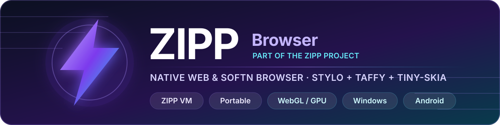
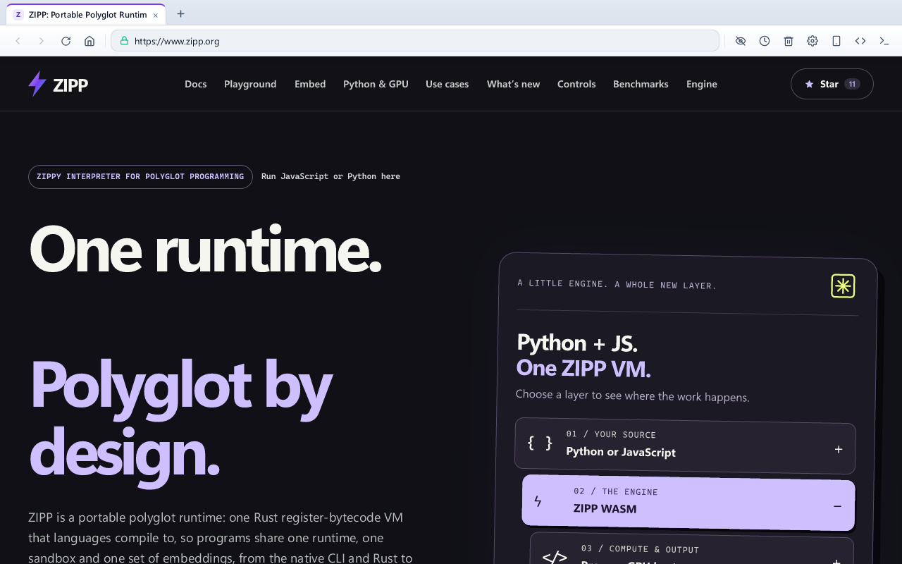
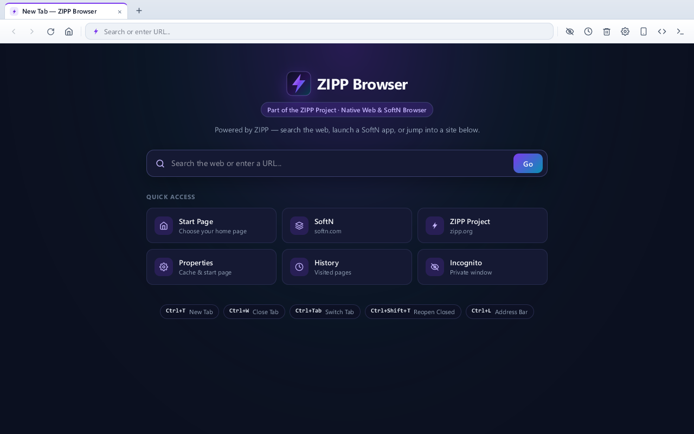
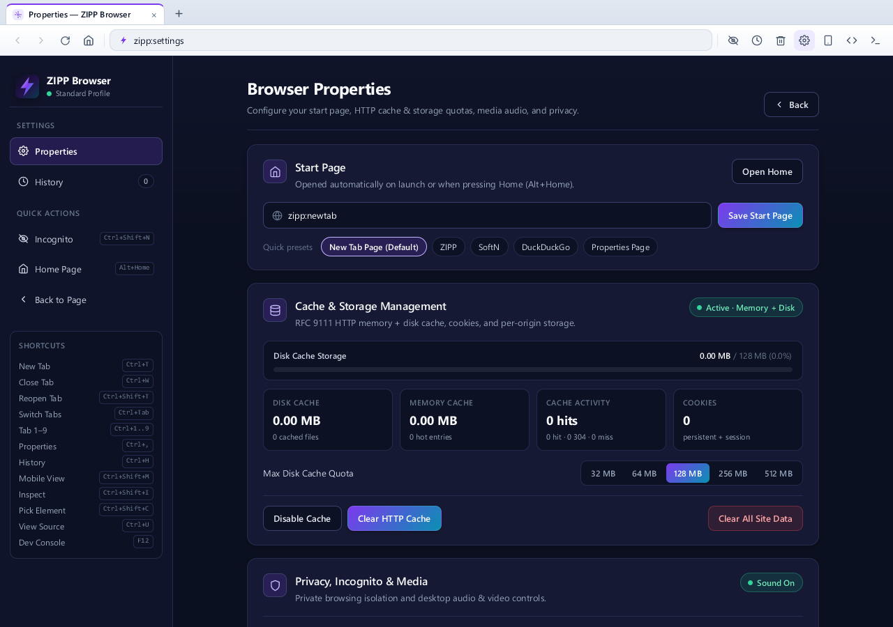
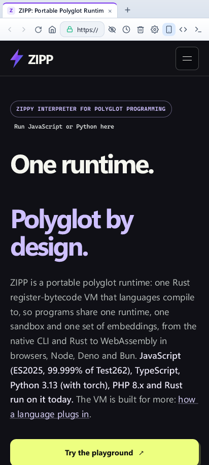

<p align="center">
  
</p>

<h1 align="center">ZIPP Browser</h1>

<p align="center">
  <strong>Part of the <a href="https://github.com/f2i-com/zipp.org">ZIPP</a> Project</strong><br>
  A native Rust web &amp; SoftN browser powered by <a href="https://www.zipp.org/">ZIPP</a> (<code>zipp-vm 0.0.40</code>), Stylo, Taffy, Parley and tiny-skia.
</p>

<p align="center">
  <a href="https://www.zipp.org/">ZIPP Website</a> ·
  <a href="https://github.com/f2i-com/zipp.org">ZIPP Runtime</a> ·
  <a href="#screenshots">Screenshots</a> ·
  <a href="#get-zipp-browser">Download</a> ·
  <a href="#architecture">Architecture</a> ·
  <a href="#building">Build</a> ·
  <a href="LICENSE-APACHE">Apache-2.0</a>
</p>

---

**ZIPP Browser is a clean-sheet native browser engine written in Rust.** Page JavaScript and TypeScript execute on [ZIPP](https://github.com/f2i-com/zipp.org) (`zipp-vm 0.0.40`) — a register VM with native x86-64/ARM64 JITs and Wasmtime-backed WebAssembly — paired with real browser subsystems below it: **Stylo** (Firefox's CSS cascade engine), **Taffy** (Flexbox, CSS Grid & Block layout), **Parley** + **Skrifa** (text shaping), and **tiny-skia** (cached software rasterization), plus hardware-accelerated **WebGL 1/2** and **WebGPU** canvases.

No Chromium, no Electron, no WebKit, and no GPU is required for page rendering — ZIPP Browser runs smoothly over RDP, as a single portable Windows folder, on bare-metal Linux DRM/KMS kiosks, and headlessly as the native Android WebView inside [SoftN Mobile](https://softn.com).

```text
fetch (HTTP/2 + RFC 9111 cache)
  → zipp-vm 0.0.40 (JS / TS / ESM / Workers / Wasmtime JIT)
  → Stylo CSS cascade → Taffy layout → tiny-skia paint
  → winit desktop · Linux KMS kiosk · Android EGL / Surface
```

## Screenshots

<p align="center">
  
  <br>
  <sub><b>Desktop Browser</b> — Rendering <code>zipp.org</code> natively with tabs, Stylo CSS, Taffy layout, ES Modules, and Web Workers on <code>zipp-vm 0.0.40</code>.</sub>
</p>

<table>
  <tr>
    <td width="50%" align="center">
      
      <br>
      <sub><b>New Tab Start Page</b> — Default first-load page with quick access &amp; ready-to-type omnibox</sub>
    </td>
    <td width="50%" align="center">
      
      <br>
      <sub><b>Properties, Cache &amp; History</b> — Start page, RFC 9111 cache quotas, Incognito &amp; browsing history</sub>
    </td>
  </tr>
</table>

<p align="center">
  
  <br>
  <sub><b>Mobile View (<code>Ctrl+Shift+M</code> / <code>--mobile</code>)</b> — Live 412&times;915 Pixel 9a viewport matching SoftN Mobile for Android</sub>
</p>

## Why ZIPP Browser

| | |
| --- | --- |
| **Powered by ZIPP** | Runs page JS/TS on `zipp-vm 0.0.40` (99.999% test262 conformance, native JIT, persistent embeddable VM, Web Workers, and Wasmtime WebAssembly). |
| **Real Engine Stack** | Uses Firefox's **Stylo** CSS engine, **Taffy** flexbox/grid/block layout, **Parley** + **Skrifa** text shaping, and a cached **tiny-skia** software painter — zero Chromium or Electron bloat. |
| **Portable by Default** | Windows releases ship as a self-contained portable `.zip` and standalone `.exe` (no installer). Drop `portable.txt` beside the binary (or pass `--portable`) and all profile data stays in `./data/`. |
| **Tabs, DevTools & Mobile View** | Multi-tab chrome, Chrome-like Inspector (Elements, Source, Loaded Scripts, Console with copy & REPL), live Desktop ↔ Mobile View (`412×915`), Incognito windows, and PDF/media viewers. |
| **Prebuilt Android WebView** | Every release publishes prebuilt `arm64-v8a` and `x86_64` `libsoftn_mobile.so` libraries so SoftN Mobile Android APKs download and embed the native engine directly without compiling Rust/NDK. |
| **Runs Anywhere** | Desktop Windows & Linux, headless `--screenshot` CI testing, `--app` chromeless mode, bare-metal Linux `--kiosk` (DRM/KMS + `evdev`), and Android JNI/EGL. |

## Get ZIPP Browser

Every [release](https://github.com/f2i-com/zipp-browser/releases) builds against the latest published [ZIPP](https://github.com/f2i-com/zipp.org/releases) release and publishes portable, checksummed files (`SHA256SUMS.txt`):

| Artifact | What it is |
| --- | --- |
| `zipp-browser-<tag>-windows-x86_64-portable.zip` | **Windows portable folder** (`zipp-browser.exe`, `portable.txt`, `LICENSE-APACHE`, `README.md`). Unzip anywhere and run — settings, cookies, history, and HTTP cache stay inside `./data/`. |
| `zipp-browser-<tag>-windows-x86_64-portable.exe` | **Standalone single-file Windows portable binary** (no installer). Pass `--portable` or place a `portable.txt` file next to it for `./data/` storage. |
| `zipp-browser-<tag>-linux-x86_64.tar.gz` | **Portable Linux x86-64 binary** (`zipp-browser`, `LICENSE-APACHE`, `README.md`), including bare-metal `--kiosk` DRM/KMS support. |
| `zipp-browser-<tag>-android-webview.zip` | **Prebuilt Android WebView native runtime** (`jniLibs/arm64-v8a/libsoftn_mobile.so`, `jniLibs/x86_64/libsoftn_mobile.so`, `manifest.json`, `SHA256SUMS.txt`) for SoftN Android APK builds. |
| `SHA256SUMS.txt` | SHA-256 digests for every artifact in the release. |

### Quick Start (Windows Portable)

```powershell
# Unzip and run — opens the New Tab page with portable ./data/ storage
Expand-Archive .\zipp-browser-v0.1.3-windows-x86_64-portable.zip -DestinationPath .\zipp-browser
.\zipp-browser\zipp-browser.exe
```

### Embedding the Prebuilt Android WebView in SoftN Mobile

SoftN Android's APK packer downloads and SHA-256 verifies `zipp-browser-<tag>-android-webview.zip` automatically instead of compiling Rust/NDK locally:

```bash
# Inside softn.com/apps/softn-android:
node scripts/pack-apk.mjs path/to/app.softn --out app.apk
```

## Architecture

| Crate / App | Responsibility |
| --- | --- |
| [`crates/zipp-dom`](crates/zipp-dom) | DOM tree, `html5ever` parsing, Stylo ↔ Taffy layout bridge, embedded Liberation fonts (Parley + `usvg`), hit-testing & events |
| [`crates/zipp-renderer`](crates/zipp-renderer) | Paint tree & tuned `tiny-skia` software rasterizer (downscaled box-shadow blur cache, glyph alpha cache, clip-mask pooling, partial canvas damage repaint) |
| [`crates/zipp-shell`](crates/zipp-shell) | `winit` windowing, cached framebuffer presentation, HTTP/2 networking, RFC 9111 HTTP disk/memory cache, RFC 6265 cookie jar, standard/portable/incognito profiles |
| [`crates/zipp-kms`](crates/zipp-kms) | Bare-metal Linux DRM/KMS + `evdev` display/input backend for `--kiosk` mode without X11 or Wayland |
| [`crates/zipp-android-webview`](crates/zipp-android-webview) | Headless Android WebView & SoftN v2 mobile native runtime (`libsoftn_mobile.so`: Stylo + Taffy + TinySkia + EGL WebGL + bundled SQLite + polyglot `zipp-vm`) |
| [`apps/browser`](apps/browser) | The `zipp-browser` desktop & kiosk binary: `zipp-vm` embed, DOM/Canvas 2D/WebGL/WebGPU/Worker shims, multi-tab UI, DevTools Inspector, Console, PDF & media viewers |

`zipp-vm` (`0.0.40`) is consumed directly from [ZIPP](https://github.com/f2i-com/zipp.org) through its `embed` module — a persistent VM compiled once per page, kept alive, and re-entered to dispatch DOM events, microtasks, timers, and `requestAnimationFrame` callbacks into the same global context.

## Running

```bash
# Desktop browser (1280x800 default viewport)
zipp-browser                                       # opens the New Tab page (or your configured start page)
zipp-browser --portable                            # stores profile data in ./data next to the executable
zipp-browser --incognito                           # private window: in-memory cookies/cache/storage, zero history
zipp-browser https://www.zipp.org                  # open a URL (bare domains like zipp.org work too)

# Mobile View (matches SoftN Mobile Android Pixel 9a logical viewport: 412x915)
zipp-browser --mobile https://www.zipp.org         # mobile viewport + Android mobile UA + touch hints
zipp-browser --viewport 390x844 https://example.com

# Chromeless App Mode & Bare-Metal Linux Kiosk Mode
zipp-browser --app https://example.com
zipp-browser --mobile --app path/to/index.html path/to/app.softn
zipp-browser --kiosk https://example.com           # Linux DRM/KMS full-screen

# Headless Screenshots (writes PNG + post-JS HTML alongside it)
zipp-browser --screenshot out.png https://www.zipp.org 1280 800
zipp-browser --mobile --screenshot mobile.png https://www.zipp.org

# Built-in Test Suites & Info
zipp-browser --test-vm                             # quick zipp-vm sanity check
zipp-browser --test-js                             # DOM/browser JS test suite
zipp-browser --test-compat                         # JS language compatibility suite
zipp-browser --version
zipp-browser --help
```

### Keyboard Shortcuts

| Shortcut | Action |
| --- | --- |
| `Ctrl+T` / `Ctrl+W` / `Ctrl+Shift+T` | New Tab / Close Tab / Reopen Closed Tab |
| `Ctrl+Tab` / `Ctrl+1..9` | Cycle Tabs / Jump to Tab 1–9 |
| `Ctrl+L` or `F6` | Focus Address Bar |
| `Alt+Left` / `Alt+Right` / `Alt+Home` | Back / Forward / Start Page |
| `F5` / `Ctrl+R` / `Ctrl+Shift+R` | Reload / Hard Reload (bypass cache) |
| `Ctrl+Shift+M` | Toggle Desktop (`1280×800`) ↔ Mobile View (`412×915`) |
| `Ctrl+Shift+I` / `Ctrl+Shift+C` / `Ctrl+U` | Inspect Panel / Pick Element / View Page Source |
| `F12` | Toggle Developer Console & JS REPL |
| `Ctrl+,` / `Ctrl+H` / `Ctrl+Shift+N` | Browser Properties / History / New Incognito Window |
| `Ctrl+=` / `Ctrl+-` / `Ctrl+0` | Zoom In / Zoom Out / Reset Zoom |
| `Alt+D` / `Alt+H` / `Alt+T` | Layout Boxes / Hover Highlight / Print Taffy Tree |

### Headless Automation Environment Switches

- `ZIPP_UICLICK=x,y[;x,y…]` — dispatches real hit-tested clicks at client coordinates before screenshot capture.
- `ZIPP_RESIZE=w,h[;w,h…]` — resizes the live page through each viewport size in turn.
- `ZIPP_COLOR_SCHEME=light|dark` — overrides OS `prefers-color-scheme` for CSS and `matchMedia`.
- `ZIPP_EMBEDDED_FONTS_ONLY=1` — forces embedded Liberation fonts only for deterministic cross-machine renders.
- `ZIPP_DEBUG_CONSOLE=1` — mirrors page/worker `console.*` messages and errors to `stderr`.
- `ZIPP_MUTE_MEDIA=1` — mutes audio/video playback for automated runs.

## Web Platform & Performance

- **Modern Web Apps & SoftN v2:** Renders React, Tailwind, Three.js, and SoftN v2 apps (Shadow DOM, constructable stylesheets, ES Modules + Import Maps linked via `oxc`, `DOMParser`, `XMLSerializer`, `FormData`).
- **WebAssembly & Web Workers:** Full `WebAssembly` API compiled to native machine code via Wasmtime Cranelift (`wasm-jit`, including `instantiateStreaming`, `wasm-bindgen`, and `externref`), plus classic & module `new Worker(url)` threads with `fetch`, timers, `importScripts`, and structured cloning.
- **2D & 3D Graphics:** `tiny-skia` Canvas 2D (`Path2D`, gradients, patterns, `drawImage`, `getImageData`/`putImageData`, `toDataURL`), hardware **WebGL 1 & 2** (Windows WGL OpenGL, Linux/Android EGL OpenGL ES 3), and **WebGPU** (Vulkan / D3D12) supporting modern Three.js `.glb`/`.hdr` PBR scenes.
- **Tuned Software Rasterizer:** Downscaled box-shadow blur cache, 1-byte glyph alpha-mask cache, clip-mask pooling, cached framebuffer move/expose blitting, solid-rect fast paths, and partial `<canvas>` overlay damage repaints (`paint_scene_from_nodes`) cutting 3D animation paint times by >30×.
- **Media & Built-in Viewers:** Windows Media Foundation `<video>` playback (H.264, VP9, AV1, MP4, WebM), WASAPI/ALSA Web Audio decoding via `symphonia`, built-in pure-Rust PDF viewer ([hayro](https://github.com/LaurenzV/hayro)), image/JSON/text viewers, and safe downloads.
- **Fonts & Site Storage:** All 12 Liberation TTF faces (`Sans`, `Serif`, `Mono`) are compiled directly into `zipp-dom` for Parley and `usvg` SVG `<text>` rendering. Profiles store cookies (`cookies.json`), RFC 9111 HTTP cache, history, and per-origin `localStorage` + IndexedDB in `./data/` (portable mode) or `%LOCALAPPDATA%\Zipp` / `$XDG_DATA_HOME/zipp` (`ZIPP_PROFILE_DIR` override).

## Building

Requires **Rust 1.92.0+** and **Node.js 22+** (only for release scripts; zero npm dependencies).

```bash
git clone https://github.com/f2i-com/zipp-browser.git
cd zipp-browser
cargo build --release --bin zipp-browser
```

### Syncing with the Latest ZIPP Release

`zipp-browser` pins `zipp-vm` to a published `f2i-com/zipp.org` release tag (currently `v0.0.40`). CI caches compiled `zipp-vm` and dependency artifacts keyed by the ZIPP release tag so browser rebuilds skip recompiling ZIPP when the tag has not changed.

```bash
# Check pinned zipp-vm tag against f2i-com/zipp.org/releases/latest
node tools/release/sync-zipp-release.mjs --check

# Update desktop + Android WebView manifests & lockfiles to the latest ZIPP release
node tools/release/sync-zipp-release.mjs --apply
```

### Packaging Portable Releases & Android WebView Locally

```bash
# Package portable Windows .exe + .zip (requires target/release/zipp-browser.exe)
node tools/release/package-release.mjs --windows --out dist-release

# Cross-compile & package Android WebView (arm64-v8a + x86_64; requires Android NDK)
node tools/release/package-release.mjs --android --build-android --abi all --out dist-release
```

### Developing Against a Local `zipp.org` Checkout

Keep `zipp-browser` and `zipp.org` side by side and add a `.cargo/config.toml` in their shared parent directory:

```toml
[patch."https://github.com/f2i-com/zipp.org"]
zipp-vm = { path = "zipp.org/crates/zipp-vm" }
```

### Headless & Mobile Embedding

`zipp-dom` and `zipp-renderer` compile cleanly without `winit` or `softbuffer`:

```toml
zipp-dom = { path = "...", default-features = false, features = ["svg", "woff-rust", "block", "flexbox", "grid"] }
zipp-renderer = { path = "...", default-features = false, features = ["svg"] }
```

`third_party/stylo` and `third_party/taffy` carry small targeted patches wired via `[patch]` (dark `color-scheme`, `@container` queries, and grid/layout fixes); see [`third_party/stylo/ZIPP_PATCHES.md`](third_party/stylo/ZIPP_PATCHES.md) and [`third_party/taffy/ZIPP_PATCHES.md`](third_party/taffy/ZIPP_PATCHES.md).

<details>
<summary><strong>Known Gaps &amp; Architecture Notes</strong></summary>

- **`-webkit-line-clamp` and `display: -webkit-box`:** Compiled out of Stylo's Servo mode; clamped text renders in full.
- **Worker termination:** `worker.terminate()` takes effect between tasks; nested workers, transferable buffers, and worker IndexedDB are not yet implemented.
- **Canvas 2D shadows & filters:** Not yet drawn; conic gradients fall back to their first stop.
- **`mask-image`:** Unsupported (elements paint unmasked rather than dropped).
- **Float avoidance for BFC blocks:** `overflow: hidden` beside floats can overlap rather than shifting beside/below.
- **Conic/sweep CSS gradients:** Fall back to their middle stop (`tiny-skia` has no sweep shader).
- **DOM bridge:** Script DOM mutations patch/re-serialize across the JS boundary rather than mutating Stylo nodes directly (see [`docs/DOM_BRIDGE_DESIGN.md`](docs/DOM_BRIDGE_DESIGN.md)).

</details>

## License

[Apache-2.0](LICENSE-APACHE).
